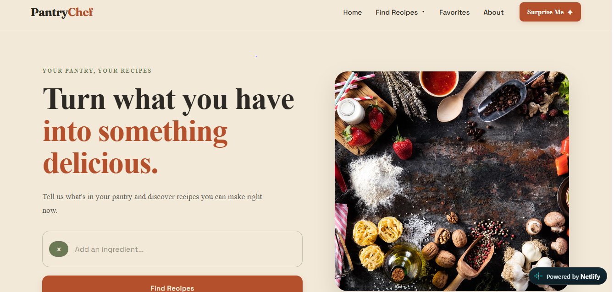

# Muhammad Hamzah — Developer Portfolio

<p align="center">
  <strong>A personal space for the things I build, the technologies I explore, and the progress I make as a web developer.</strong>
</p>

<p align="center">
  <a href="https://nextjs.org/"></a>
  <a href="https://react.dev/"></a>
  <a href="https://tailwindcss.com/"></a>
  
  <a href="https://github.com/hamzah697/Portfolio"></a>
</p>

<p align="center">
  <a href="#-overview">Overview</a> ·
  <a href="#-featured-projects">Projects</a> ·
  <a href="#-tech-stack">Tech stack</a> ·
  <a href="#-run-locally">Run locally</a> ·
  <a href="#-connect">Connect</a>
</p>

---

## ✦ Overview

This portfolio is more than a list of technologies. It is a snapshot of my journey as a web developer — the way I think about building for the web, the tools I'm learning, and the projects I've worked on along the way.

The visual direction is **editorial, minimal, and expressive**: a warm light palette, charcoal typography, muted plum accents, layered portrait artwork, generous spacing, and subtle motion.

## ✦ Explore the portfolio

| Section | What you'll find |
| --- | --- |
| **Hero** | A short introduction, portrait composition, and ways to explore the site. |
| **Introduction** | My approach to development and what I'm working towards. |
| **What I Do** | An overview of my frontend, backend, and database interests. |
| **Featured Projects** | Selected work with project context, technologies, and repository links. |
| **Toolkit** | The technologies I'm learning and practising. |
| **Footer** | Navigation and contact details. |

## ✦ Featured projects

### 01 — PantryChef

An ingredient-based recipe discovery app. Add ingredients you have available and explore matching recipes, with links to the original recipe source.

<p align="center">
  <a href="https://github.com/hamzah697/PantryChef">
    
  </a>
</p>
<p align="center"><sub>Click the preview to explore the PantryChef repository.</sub></p>

**Built with:** React · JavaScript · Spoonacular API

[↗ Explore PantryChef on GitHub](https://github.com/hamzah697/PantryChef)

### 02 — Notes API

A REST API with create, read, update, and delete operations backed by MySQL. It includes registration and login, password hashing, JWT authentication, and ownership checks so users can access only their own notes.

**Built with:** Node.js · Express.js · MySQL · JWT · bcrypt

[↗ Explore Notes API on GitHub](https://github.com/hamzah697/Notes_API)

## ✦ Design & experience

- **Editorial hierarchy** — expressive headlines, serif italic accents, and compact monospace labels.
- **Warm, restrained palette** — light backgrounds, charcoal text, and muted plum accents.
- **Intentional spacing** — generous section spacing and clear content groupings.
- **Responsive layouts** — compositions adapt to desktop, tablet, and mobile screens.
- **Lightweight motion** — scroll reveals and CSS transitions add movement without relying on heavy animation.
- **Reusable components** — each major page section is separated into its own React component.

## ✦ Tech stack

<p>
  
  
  
  
  
  
</p>

| Technology | How it is used |
| --- | --- |
| [Next.js 16](https://nextjs.org/) | Application framework and routing |
| [React 19](https://react.dev/) | Reusable UI components |
| [Tailwind CSS 4](https://tailwindcss.com/) | Utility-first styling and responsive layouts |
| JavaScript | Application and component logic |
| CSS | Custom styling, transitions, and animation |
| Git & GitHub | Version control and source hosting |

## ✦ Run locally

Want to explore the code or run the portfolio on your machine?

<details open>
  <summary><strong>1. Clone the repository</strong></summary>

  ```bash
  git clone https://github.com/hamzah697/Portfolio.git
  cd Portfolio
  ```
</details>

<details>
  <summary><strong>2. Install dependencies</strong></summary>

  ```bash
  npm install
  ```
</details>

<details>
  <summary><strong>3. Start the development server</strong></summary>

  ```bash
  npm run dev
  ```

  Open [http://localhost:3000](http://localhost:3000) in your browser.
</details>

### Available scripts

| Command | Description |
| --- | --- |
| `npm run dev` | Start the development server |
| `npm run build` | Create a production build |
| `npm run start` | Start the production server |
| `npm run lint` | Run ESLint |

## ✦ Project structure

<details>
  <summary><strong>View the source structure</strong></summary>

  ```text
  Portfolio/
  ├── public/
  │   └── images/
  │       ├── pantrychef-preview.PNG
  │       └── potrait.png
  │
  ├── src/
  │   └── app/
  │       ├── Components/
  │       │   ├── Footer.jsx
  │       │   ├── Hero.jsx
  │       │   ├── Introduction.jsx
  │       │   ├── Navbar.jsx
  │       │   ├── Projects.jsx
  │       │   ├── Reveal.jsx
  │       │   ├── Scrollreveal.jsx
  │       │   ├── Sculpture.jsx
  │       │   ├── Skills.jsx
  │       │   ├── Whatido.jsx
  │       │   └── site.js
  │       ├── favicon.ico
  │       ├── globals.css
  │       ├── layout.js
  │       └── page.js
  │
  ├── package.json
  └── README.md
  ```
</details>

## ✦ Current focus

- [x] Build a component-based portfolio with Next.js and React.
- [x] Create a responsive visual direction with custom portrait artwork.
- [x] Add subtle reveal and transition effects.
- [x] Showcase frontend and backend projects.
- [ ] Add dedicated desktop and mobile screenshots of the portfolio itself.
- [ ] Continue refining accessibility, keyboard navigation, and responsive behaviour.
- [ ] Add new projects as I build them.

## ✦ Customization

<details>
  <summary><strong>Where to make changes</strong></summary>

  - **Page sections:** edit the components inside `src/app/Components/`.
  - **Portrait:** replace `public/images/potrait.png`.
  - **Projects:** update project content and repository links in `Projects.jsx`.
  - **Skills:** update the technologies and progress labels in `Skills.jsx`.
  - **Global styling:** adjust the design tokens and styles in `globals.css`.
</details>

## ✦ Connect

I'm learning by building, experimenting, and sharing the process.

- **GitHub:** [github.com/hamzah697](https://github.com/hamzah697)
- **Portfolio repository:** [github.com/hamzah697/Portfolio](https://github.com/hamzah697/Portfolio)

---

<p align="center">
  <strong>Built with curiosity, code, and a lot of iteration.</strong>
  <br />
  <sub>Muhammad Hamzah · Web Developer</sub>
</p>
